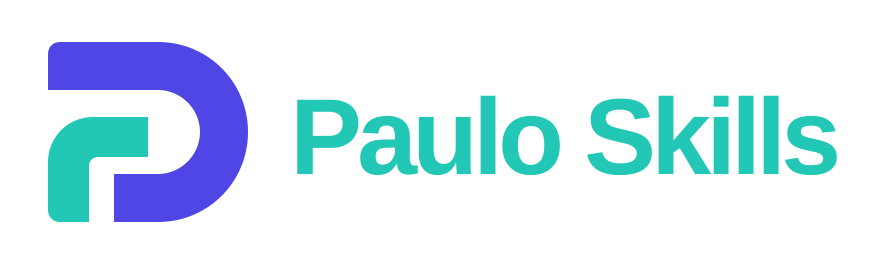
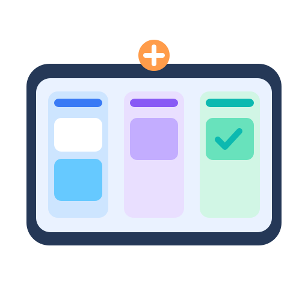
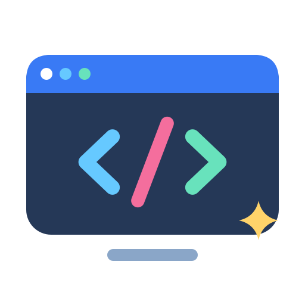
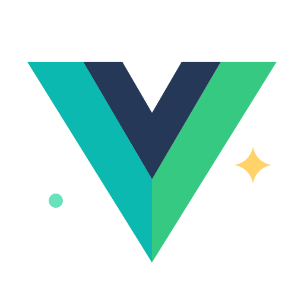
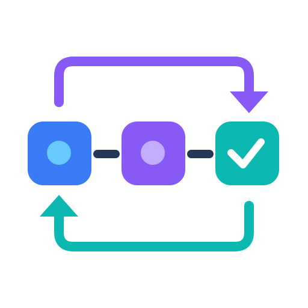
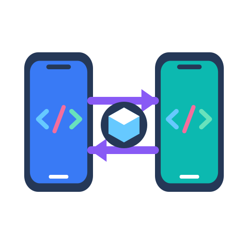
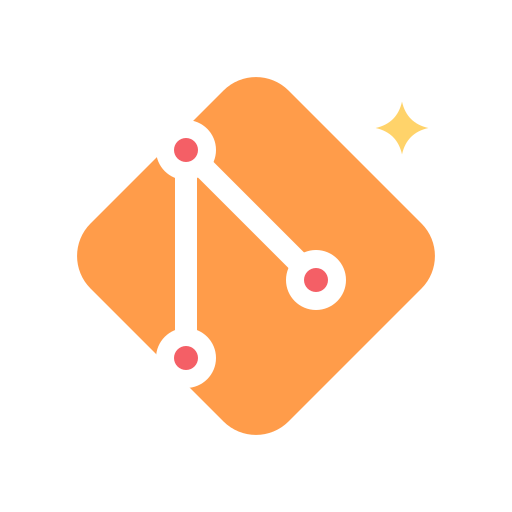
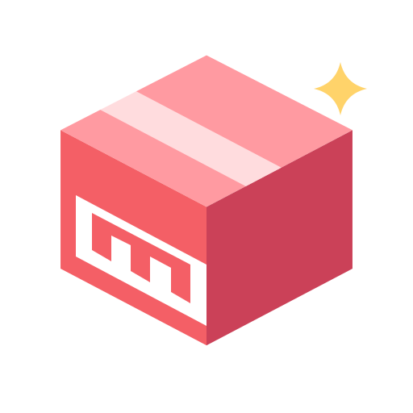
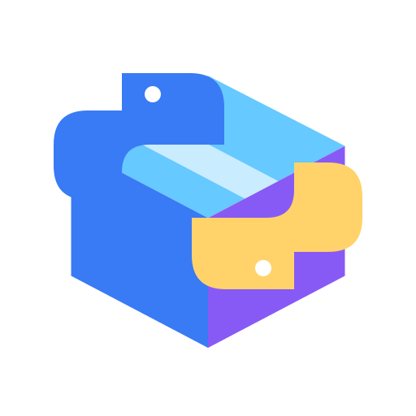
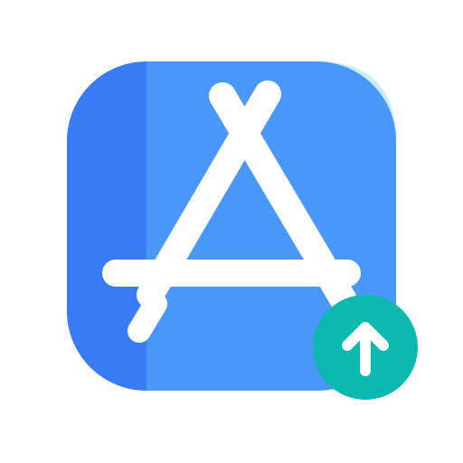

<p align="center">
  <a href="https://github.com/paulocoutinhox/skills">
    <picture>
      <source media="(prefers-color-scheme: dark)" srcset="extras/images/logo-dark.svg">
      
    </picture>
  </a>
</p>

<p align="center">
  <a href="https://github.com/paulocoutinhox/skills/actions/workflows/validate.yml"></a>
  <a href="LICENSE.md"></a>
  <a href="https://agentskills.io/specification"></a>
</p>

<p align="center">
Practical, reusable skills for AI coding agents. Plan work, build software, test apps, create content and ship products.
</p>

<br>

## 🚀 Project

**Paulo Skills** is a collection of independent, researched skills for Codex, Claude Code and other clients that support the [Agent Skills format](https://agentskills.io/specification).

Each skill is written in English and contains a focused `SKILL.md`, with references and templates where useful. Install the entire collection or choose just the skills you need.

The skills separate official requirements from practical defaults and recommendations. Recheck changing platform and print requirements before publishing. External publishing requires your approval.

Created by [Paulo Coutinho](https://paulox.dev/), a software developer with more than 20 years of experience. The focus is clear structure, readable code and practical checks.

## 📦 Install

Install the whole collection for Codex and Claude Code for your user account with the
[Vercel Skills CLI](https://github.com/vercel-labs/skills/tree/v1.9.0) (Node.js 22.20 or later).

```bash
npx skills@1.9.0 add paulocoutinhox/skills -g -a codex claude-code -s '*'
```

Run the same command again to update the whole collection. The
[installation guide](docs/installation.md) covers project installs, single skills, updates and
removal.

## 💡 How to use

Name a skill, such as `$code-developer` in Codex or `/code-developer` in Claude Code, and describe
the task. The [usage guide](docs/usage.md) has examples for each client. The
[task prompts](docs/task-prompts.md) have complete prompts to copy, with inputs, expected results and
checks.

## ✨ Skills

Explore all 32 skills. Each one is independent and links directly to its instructions.

| Image | Skill | What it does | Instructions |
| :---: | --- | --- | --- |
|  | `skill-creator` | Create, improve and validate portable agent skills. | [SKILL.md](skills/skill-creator/SKILL.md) |
|  | `markdown-kanban` | Organize tasks in a local Markdown Kanban board, with linked cards and an archive. | [SKILL.md](skills/markdown-kanban/SKILL.md) |
|  | `book-creator` | Lay out books and A4 workbooks with print-ready interiors and covers. | [SKILL.md](skills/book-creator/SKILL.md) |
|  | `code-developer` | Write production-ready code and documentation across languages. | [SKILL.md](skills/code-developer/SKILL.md) |
|  | `vue-app` | Build modular Vue apps with components, composables and clear state. | [SKILL.md](skills/vue-app/SKILL.md) |
|  | `react-app` | Build modular React apps with hooks, components and async lifecycle checks. | [SKILL.md](skills/react-app/SKILL.md) |
|  | `tailwind-css` | Design accessible Tailwind CSS interfaces with tokens and variants. | [SKILL.md](skills/tailwind-css/SKILL.md) |
|  | `queuefy` | Integrate durable Python queues, schedules, retries and idempotency. | [SKILL.md](skills/queuefy/SKILL.md) |
|  | `cachefy` | Add Python caching with scoped storage, freshness and invalidation. | [SKILL.md](skills/cachefy/SKILL.md) |
|  | `kaktos-site` | Create static Kaktos sites with Jinja, integrated assets and frozen routes. | [SKILL.md](skills/kaktos-site/SKILL.md) |
|  | `fastkit-app` | Build and extend Fastkit sites, admin panels and APIs. | [SKILL.md](skills/fastkit-app/SKILL.md) |
|  | `xplpc-mobile` | Connect native mobile apps to a shared C++ core with XPLPC. | [SKILL.md](skills/xplpc-mobile/SKILL.md) |
|  | `haylen-app` | Build Haylen apps, games, native plugins and template-based project upgrades. | [SKILL.md](skills/haylen-app/SKILL.md) |
|  | `reliable-information` | Answer factual questions with verified evidence, citations and clear uncertainty. | [SKILL.md](skills/reliable-information/SKILL.md) |
|  | `web-app-testing` | Test web apps with Playwright and supported cloud services. | [SKILL.md](skills/web-app-testing/SKILL.md) |
|  | `git` | Prepare and review Git changes with task-aware commit naming. | [SKILL.md](skills/git/SKILL.md) |
|  | `npm-library` | Build npm libraries with explicit exports and trusted publishing. | [SKILL.md](skills/npm-library/SKILL.md) |
|  | `pypi-library` | Build and test Python packages with trusted publishing. | [SKILL.md](skills/pypi-library/SKILL.md) |
|  | `social-post` | Prepare publishing fields for YouTube, Shorts, TikTok, Instagram, X and LinkedIn. | [SKILL.md](skills/social-post/SKILL.md) |
|  | `social-thumbnail` | Create readable thumbnails and verify exported artwork. | [SKILL.md](skills/social-thumbnail/SKILL.md) |
|  | `remotion` | Create animated React videos with motion, narration, captions and verified renders. | [SKILL.md](skills/remotion/SKILL.md) |
|  | `editor-config` | Set consistent editor rules for the repository's actual file types. | [SKILL.md](skills/editor-config/SKILL.md) |
|  | `git-ignore` | Exclude private and generated files while keeping source and lockfiles. | [SKILL.md](skills/git-ignore/SKILL.md) |
|  | `code-review` | Review code changes and trace their impact across the system. | [SKILL.md](skills/code-review/SKILL.md) |
|  | `android-app-testing` | Test Android apps on emulators, physical devices and cloud labs from Windows, macOS or Linux. | [SKILL.md](skills/android-app-testing/SKILL.md) |
|  | `apple-app-testing` | Test iOS, iPadOS, tvOS, macOS, visionOS and watchOS apps on supported destinations. | [SKILL.md](skills/apple-app-testing/SKILL.md) |
|  | `cloud-batch` | Run build and test batches across local machines, CI and cloud services, with cost and cleanup checks. | [SKILL.md](skills/cloud-batch/SKILL.md) |
|  | `security-audit` | Audit security and authorization across web, API, mobile and desktop. | [SKILL.md](skills/security-audit/SKILL.md) |
|  | `app-store-connect` | Build Apple apps and manage store listings, ASO, products, pricing and releases. | [SKILL.md](skills/app-store-connect/SKILL.md) |
|  | `google-play` | Build Android bundles and manage Google Play listings, billing and releases. | [SKILL.md](skills/google-play/SKILL.md) |
|  | `revenuecat` | Configure subscription projects, entitlements, offerings, paywalls and purchase lifecycles. | [SKILL.md](skills/revenuecat/SKILL.md) |
|  | `playgama` | Build HTML5 games with Bridge and manage review, monetization and publication. | [SKILL.md](skills/playgama/SKILL.md) |

## 📚 Documentation

| Guide | Contents |
| --- | --- |
| [Installation](docs/installation.md) | Install, update and remove skills at user or project scope. |
| [Usage](docs/usage.md) | How to call skills in each client, examples and where the skills keep their knowledge. |
| [Task prompts](docs/task-prompts.md) | Ready-to-copy prompts for every skill, grouped by task. |
| [Development](docs/development.md) | Local and CI checks and how the repository is organized. |

## 🤝 Contributing

Read [AGENTS.md](AGENTS.md) for all repository-wide rules on writing, research, organization,
structure, checks and delivery.

## ☕ Buy me a coffee

Support the ongoing work on this project.

<a href="https://ko-fi.com/A0A412XEV"></a>

## 📄 License

[MIT](LICENSE.md)

Copyright (c) 2026, Paulo Coutinho

---

Made with ❤️ by [Paulo Coutinho](https://github.com/paulocoutinhox)
